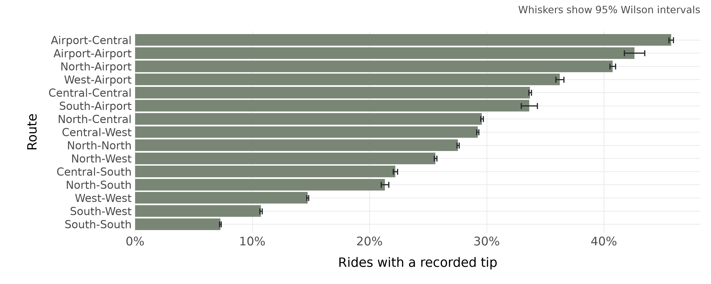
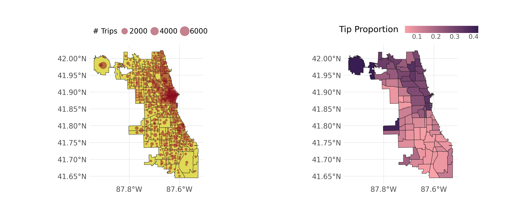
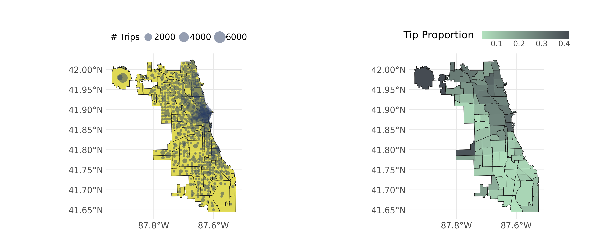
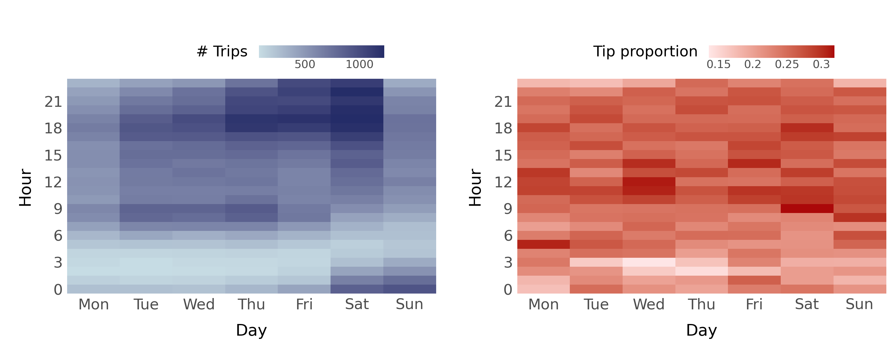

# Tipping patterns in Chicago

*Alessandro Ferrera*

Of **6,349,902 complete Chicago ride-hailing trips**, **1,613,010 (25.4%)** had a recorded tip. Could the route, fare and pickup time help an app anticipate which riders will tip before it suggests an amount?

[Read the analysis notebook](Chicago_Tipping.ipynb) · [View the presentation (PDF)](Chicago%20riders.pdf) · [Get the trip data](#data-access)

## How tipping varied across rides

The highest recorded tip rate was **45.7%** on the 251,955 rides between O’Hare and the Central zone. It was **7.3%** on the 478,322 rides that began and ended in the South zone. The chart covers all 15 zone pairs and counts both directions together. [Route counts and rates](report/tables/routes.csv)



The **pickup map** groups complete rides by the Chicago community area where they started. Darker purple on the right means a higher share of rides with a recorded tip. Larger circles on the left mark busier pickup clusters in a sample of 100,000 rides.



The **drop-off map** shows the same rate for rides ending in each area, with drop-off clusters from the same sample on the left. O’Hare has a relatively high recorded tip rate for both pickups and drop-offs.



A tip was recorded on **21.9%** of overnight rides (23:00–07:00), compared with **26.2%** of rides starting between 07:00 and 15:00. The heatmaps show how trip volume (left) and the share with a recorded tip (right) varied by pickup hour and day of the week in a sample of 100,000 rides.



In the fare sample, **17.6%** of trips with fares up to USD 5 had a recorded tip, rising to **38.2%** for fares above USD 25. Across all complete trips, the rate was **26.1%** when one booking used the car and **7.7%** when two bookings shared it. [Fare and additional charges chart](report/plots/fare.png) · [Pooling chart](report/plots/pooled.png) · [Pooling counts and rates](report/tables/pool_levels.csv)

The additional charges panel displays groups up to USD 25. The pooling chart displays one to five bookings. Whiskers show pointwise **95% Wilson intervals** under a model of independent rides. The route and pooling intervals give a model-based reference for rates calculated from complete October records. [Wilson intervals](https://www.itl.nist.gov/div898/handbook/prc/section2/prc241.htm)

## How accurately could a tip be predicted?

The models used route, fare, extra charges, pooling and pickup timing. Each route’s score came from training rides only. The **967,806 held-out rides** contained equal numbers with and without a recorded tip, so always predicting one class would give 50% accuracy.

| Model | Accuracy | Tip precision | Tip recall | Tip-class F1 |
| --- | ---: | ---: | ---: | ---: |
| Logistic regression | 60.62% | 58.15% | 75.79% | 0.6581 |
| Lasso logistic regression | 60.57% | 58.07% | 76.01% | 0.6584 |
| Classification tree | 60.57% | 58.29% | 74.38% | 0.6536 |

The route score accounted for **85.0%** of the tree’s variable importance. Even on the highest-rate route, more than half of rides ended without a recorded tip. [Tree variable importance](report/tables/tree_importance.csv) · [Model results](report/tables/model_summary.csv)

## What should the app test?

The City rounds in-app tips to the nearest dollar and excludes cash. A recorded zero can therefore include a small in-app tip or a cash tip. The records also omit the suggestion a rider saw. [City trip records and field definitions](https://data.cityofchicago.org/d/n26f-ihde)

The presentation proposes validating the model on a later month at its observed tip rate. An A/B test could then compare the standard suggestion with a higher or lower suggestion based on the prediction. Random assignment within each predicted class would allow the app to measure the change in **mean in-app tip dollars per ride**, including rides with zero tips.

## Data access

On a fresh checkout, running the notebook with its default settings automatically downloads the October 2024 trip records from the Chicago Data Portal. It saves one compressed CSV per day in `data/public_october_2024/`. Later runs reuse those files and download only missing dates. [City of Chicago trip data](https://data.cityofchicago.org/d/n26f-ihde)

If you already have a local October extract, save it as `data/Chicago_rides_october24.csv` or `data/Chicago_rides_october24.csv.gz`. For a different filename, set `TRIPS_FILE` to its path in the notebook’s first code cell.

The notebook’s saved figures and results are visible on GitHub. The repository also includes the community-area boundaries used in the maps. [Community-area boundary data](https://data.cityofchicago.org/d/igwz-8jzy)

## Run the notebook

To run the notebook locally, start in the project directory with Python 3.12.

```bash
python3.12 -m venv .venv
source .venv/bin/activate
python -m pip install -r requirements.txt
python -m jupyterlab Chicago_Tipping.ipynb
```

Run the cells in order to regenerate the figures and tables. [Figures in PNG and PDF](report/plots/) · [Tables in CSV](report/tables/)
